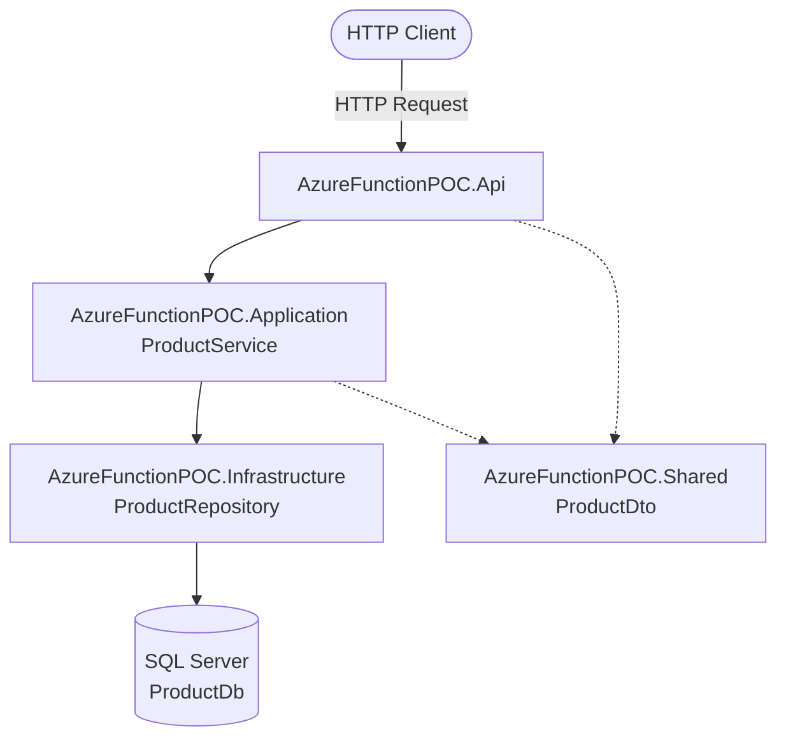

# AzureFunctionPOC

A **Proof of Concept (POC)** project demonstrating how to build serverless REST APIs using **Azure Functions, .NET 8 Isolated Worker, Entity Framework Core, and SQL Server**.

The project follows a clean, layered **N-Tier Architecture**, separating API endpoints, business logic, data access, and shared DTOs to improve maintainability, scalability, and testability.

## 🏗️ Solution Architecture

The solution is organized into four projects:

```text
AzureFunctionPOC.sln
│
├── AzureFunctionPOC.Api
│   ├── Functions/
│   │   └── ProductFunction.cs
│   ├── Models/
│   │   └── ApiResponse.cs
│   ├── Program.cs
│   ├── host.json
│   └── local.settings.json
│
├── AzureFunctionPOC.Application
│   ├── Interfaces/
│   │   └── IProductService.cs
│   └── Services/
│       └── ProductService.cs
│
├── AzureFunctionPOC.Infrastructure
│   ├── Data/
│   │   └── AppDbContext.cs
│   ├── Entities/
│   │   └── Product.cs
│   ├── Interfaces/
│   │   └── IProductRepository.cs
│   └── Repositories/
│       └── ProductRepository.cs
│
└── AzureFunctionPOC.Shared
    └── Models/
        └── ProductDto.cs
```

### Architecture Flow



### Responsibilities of Each Layer

| Project | Responsibility |
|---|---|
| `AzureFunctionPOC.Api` | HTTP triggers, request handling, dependency injection, and API responses |
| `AzureFunctionPOC.Application` | Business logic and service interfaces |
| `AzureFunctionPOC.Infrastructure` | EF Core DbContext, database entities, repositories, and SQL Server access |
| `AzureFunctionPOC.Shared` | Shared Data Transfer Objects (DTOs) |

## 🚀 Key Features

- Serverless REST API using Azure Functions v4.
- .NET 8 Isolated Worker model.
- Clean N-Tier Architecture.
- Entity Framework Core with SQL Server.
- Repository and service patterns.
- Dependency Injection.
- Generic API response wrapper.
- Product retrieval and creation endpoints.
- Entity-to-DTO mapping.
- Server-managed creation date and active status.
- Local development support.
- Ready for future Azure deployment and enhancements.

## 🛠️ Technology Stack

| Component | Technology |
|---|---|
| Programming Language | C# |
| Framework | .NET 8 |
| Serverless Runtime | Azure Functions v4 |
| Worker Model | .NET Isolated Worker |
| API Integration | HTTP Triggers |
| ORM | Entity Framework Core |
| Database | Microsoft SQL Server |
| Dependency Injection | Microsoft.Extensions.DependencyInjection |
| HTTP Extensions | Microsoft.Azure.Functions.Worker.Extensions.Http.AspNetCore |
| Local Storage Emulator | Azurite |
| API Testing | Postman or curl |

## 📁 Project Structure Details

### 1. AzureFunctionPOC.Api

The API layer is the entry point of the application.

**Main files:**

- `Program.cs` — Application startup, dependency injection, and database configuration.
- `Functions/ProductFunction.cs` — HTTP-triggered functions for retrieving and creating products.
- `Models/ApiResponse.cs` — Generic API response model.
- `host.json` — Azure Functions host configuration.
- `local.settings.json` — Local development settings and connection strings.

### 2. AzureFunctionPOC.Application

The application layer contains business logic and service contracts.

**Main files:**

- `Interfaces/IProductService.cs` — Product service interface.
- `Services/ProductService.cs` — Implements business logic and coordinates repository operations.

### 3. AzureFunctionPOC.Infrastructure

The infrastructure layer manages database access using Entity Framework Core.

**Main files:**

- `Data/AppDbContext.cs` — EF Core database context.
- `Entities/Product.cs` — Product database entity.
- `Interfaces/IProductRepository.cs` — Repository interface.
- `Repositories/ProductRepository.cs` — Repository implementation.

### 4. AzureFunctionPOC.Shared

Contains shared models used across application layers.

**Main files:**

- `Models/ProductDto.cs` — Product Data Transfer Object used for API requests and responses.

## 🔌 API Endpoints

The API exposes the following endpoints.

| Method | Endpoint | Description |
|---|---|---|
| GET | `/api/GetProducts` | Retrieves the list of products |
| POST | `/api/CreateProduct` | Creates a new product |

**Authorization:** The endpoints use `AuthorizationLevel.Function`. When running locally or in Azure, supply a valid function key as required by the configured authorization level.

### 1. Get Products

**Endpoint**

```http
GET /api/GetProducts
```

**Local URL**

```text
http://localhost:7071/api/GetProducts
```

**Sample response — 200 OK**

```json
{
  "success": true,
  "message": "Products fetched successfully.",
  "data": [
    {
      "id": 1,
      "name": "Laptop",
      "category": "Electronics",
      "description": "High performance laptop",
      "brand": "Dell",
      "price": 75000.00,
      "quantity": 10
    }
  ]
}
```

### 2. Create Product

**Endpoint**

```http
POST /api/CreateProduct
```

**Local URL**

```text
http://localhost:7071/api/CreateProduct
```

**Content-Type**

```http
Content-Type: application/json
```

**Sample request body**

```json
{
  "name": "Laptop",
  "category": "Electronics",
  "description": "High performance laptop",
  "brand": "Dell",
  "price": 75000.00,
  "quantity": 10
}
```

**Sample response — 201 Created**

```json
{
  "success": true,
  "message": "Product created successfully.",
  "data": {
    "id": 1,
    "name": "Laptop",
    "category": "Electronics",
    "description": "High performance laptop",
    "brand": "Dell",
    "price": 75000.00,
    "quantity": 10
  }
}
```

**Sample response — 400 Bad Request**

```json
{
  "success": false,
  "message": "Request body is required.",
  "data": null
}
```

The exact response status codes and validation behavior depend on the implementation in `ProductFunction.cs`.

## 🗄️ Data Model

### Product Entity

| Property | Type | Description |
|---|---|---|
| Id | int | Primary key, generated by the database |
| Name | string | Product name |
| Category | string | Product category |
| Description | string | Product description |
| Brand | string | Product brand |
| Price | decimal | Product price |
| Quantity | int | Available stock quantity |
| IsActive | bool | Indicates whether the product is active |
| CreatedDate | DateTime | Product creation timestamp in UTC |

The `IsActive` and `CreatedDate` properties are managed server-side by the application service and are not exposed as client-editable fields in the DTO.

## ⚙️ Dependency Injection

Dependencies are registered in `Program.cs`.

Example registration:

```csharp
builder.Services.AddDbContext<AppDbContext>(options =>
    options.UseSqlServer(
        builder.Configuration.GetConnectionString("DefaultConnection")));

builder.Services.AddScoped<IProductService, ProductService>();

builder.Services.AddScoped<IProductRepository, ProductRepository>();
```

### Request Processing Flow

1. The client sends an HTTP request to an Azure Function.
2. The function validates and processes the request.
3. The application service executes the business logic.
4. The repository interacts with SQL Server through Entity Framework Core.
5. The service maps database entities to DTOs.
6. The function returns a standardized API response.

## 📦 Standard API Response

The application uses a generic response wrapper to maintain a consistent response structure.

```csharp
public class ApiResponse<T>
{
    public bool Success { get; set; }

    public string Message { get; set; }

    public T? Data { get; set; }
}
```

| Property | Description |
|---|---|
| Success | Indicates whether the operation succeeded |
| Message | Describes the result |
| Data | Contains the response payload or null |

## 🚦 Getting Started

### Prerequisites

Install the following tools:

- [.NET 8 SDK](https://dotnet.microsoft.com/download/dotnet/8.0)
- [Azure Functions Core Tools v4](https://learn.microsoft.com/azure/azure-functions/functions-run-local)
- [Microsoft SQL Server](https://www.microsoft.com/sql-server)
- [SQL Server Management Studio](https://learn.microsoft.com/sql/ssms/download-sql-server-management-studio-ssms)
- [Azurite](https://learn.microsoft.com/azure/storage/common/storage-use-azurite)
- EF Core CLI tools

Install EF Core CLI tools if required:

```bash
dotnet tool install --global dotnet-ef
```

If already installed, update the tool:

```bash
dotnet tool update --global dotnet-ef
```

### Step 1: Clone the Repository

Replace the placeholder with your actual GitHub repository URL.

```bash
git clone <your-repository-url>
cd AzureFunctionPOC
```

### Step 2: Configure the Database

Open:

```text
AzureFunctionPOC.Api/local.settings.json
```

Configure the local settings:

```json
{
  "IsEncrypted": false,
  "Values": {
    "AzureWebJobsStorage": "UseDevelopmentStorage=true",
    "FUNCTIONS_WORKER_RUNTIME": "dotnet-isolated"
  },
  "ConnectionStrings": {
    "DefaultConnection": "Server=.;Database=ProductDb;Trusted_Connection=True;TrustServerCertificate=True"
  }
}
```

Update the SQL Server connection string to match your local environment.

**Important:** Ensure SQL Server is running and Azurite is available if you use the local storage emulator configuration.

Do not commit passwords, access keys, or production connection strings to GitHub.

### Step 3: Restore Dependencies

Run these commands from the solution root:

```bash
dotnet restore
dotnet build
```

### Step 4: Configure Entity Framework Core Migrations

If migrations have not already been created, run:

```bash
dotnet ef migrations add InitialCreate \
  --project AzureFunctionPOC.Infrastructure \
  --startup-project AzureFunctionPOC.Api
```

Apply the migration to the database:

```bash
dotnet ef database update \
  --project AzureFunctionPOC.Infrastructure \
  --startup-project AzureFunctionPOC.Api
```

These commands assume that EF Core design-time configuration and project references are set up correctly. If your solution uses a separate design-time DbContext factory or a different startup configuration, adjust the commands accordingly.

### Step 5: Run the Azure Function App

Navigate to the API project:

```bash
cd AzureFunctionPOC.Api
```

Start the application:

```bash
func start
```

The functions should be available at:

```text
http://localhost:7071/api/GetProducts
http://localhost:7071/api/CreateProduct
```

For local testing, obtain the function key from the local Functions host output if required.

## 🧪 Testing the APIs

You can test the endpoints using Postman or curl.

**Get products**

```bash
curl "http://localhost:7071/api/GetProducts"
```

**Create a product**

```bash
curl -X POST "http://localhost:7071/api/CreateProduct" \
  -H "Content-Type: application/json" \
  -d '{
    "name": "Laptop",
    "category": "Electronics",
    "description": "High performance laptop",
    "brand": "Dell",
    "price": 75000.00,
    "quantity": 10
  }'
```

If the function requires a key, append `?code=<your-function-key>` to the request URL.

## 🔐 Security and Configuration

- Keep `local.settings.json` out of source control when it contains local configuration or secrets.
- Use Azure Application Settings or an appropriate secrets-management solution for deployed environments.
- Never store production credentials directly in source code.
- Use HTTPS and appropriate authentication and authorization for production APIs.
- Apply least-privilege database permissions.
- Validate request payloads and handle database errors appropriately.
- Use managed identity where supported and appropriate for Azure-hosted resources.

## 📊 Logging and Monitoring

Azure Functions can integrate with Application Insights for monitoring and diagnostics.

Application Insights configuration may be enabled through the project configuration and Azure application settings. Verify the relevant packages and configuration in `Program.cs` and `AzureFunctionPOC.Api.csproj`.

Recommended monitoring includes:

- Function execution failures.
- Request duration and response codes.
- Dependency failures.
- Database connectivity issues.
- Application exceptions.

## ☁️ Azure Deployment

The project can be extended and deployed to Azure Functions.

Typical deployment steps:

1. Create an Azure Function App configured for .NET 8 Isolated Worker.
2. Configure the required storage account.
3. Configure the SQL Server connection string using Azure application settings.
4. Deploy the published Function App.
5. Apply database migrations through a controlled deployment process.
6. Verify the API endpoints and function authorization.
7. Configure monitoring with Application Insights.

Check the current Azure Functions hosting requirements before deployment to ensure the selected hosting plan supports the project's runtime and configuration.

## 📝 Important Notes

- The project uses the .NET 8 Isolated Worker model.
- Azure Functions Core Tools v4 is required for local execution.
- `local.settings.json` is intended for local development and is not published with the deployed application by default.
- Database migrations must be applied before database-dependent endpoints can work.
- `IsActive` and `CreatedDate` are managed by the application service.
- Function keys provide function-level access control but are not a replacement for a complete user authentication and authorization strategy.
- Confirm that the project references, NuGet packages, migration setup, and endpoint implementations match the examples in this README.

## 🎯 Learning Objectives

This POC demonstrates:

- Building HTTP APIs with Azure Functions.
- Implementing clean, layered application architecture.
- Applying Dependency Injection in .NET.
- Separating business logic from database access.
- Using the Repository Pattern.
- Working with Entity Framework Core and SQL Server.
- Creating consistent API response models.
- Managing local configuration and database migrations.
- Preparing serverless applications for Azure deployment.

## 📌 Future Enhancements

Potential improvements include:

- Add product update and delete endpoints.
- Introduce request validation.
- Add centralized exception handling.
- Implement structured logging and correlation IDs.
- Add unit and integration tests.
- Integrate Azure Key Vault.
- Add authentication using Microsoft Entra ID.
- Add CI/CD using GitHub Actions or Azure DevOps.
- Add Polly-based resilience policies where supported and useful for external service or database-related transient failures.

## 📄 License

This project is intended for proof-of-concept and learning purposes. Add an appropriate license file if you plan to distribute or reuse the project publicly.
